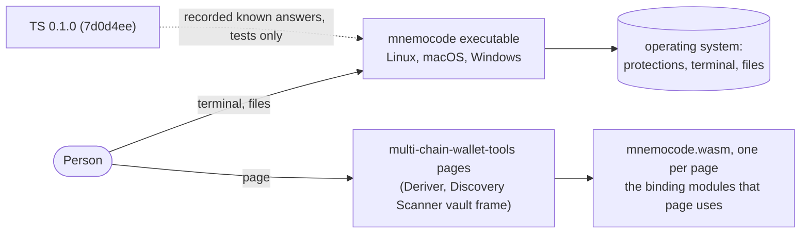
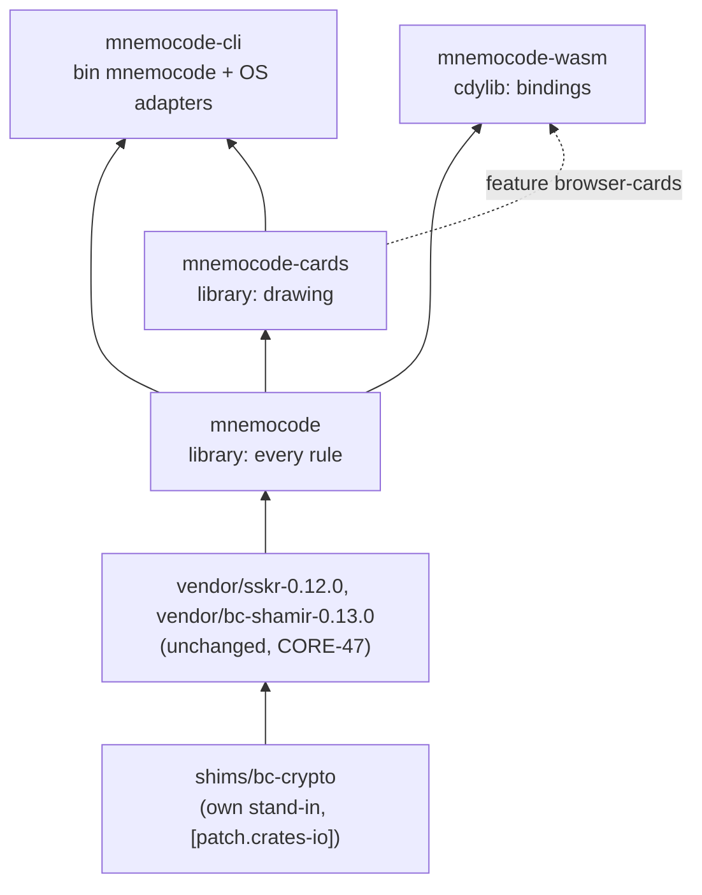
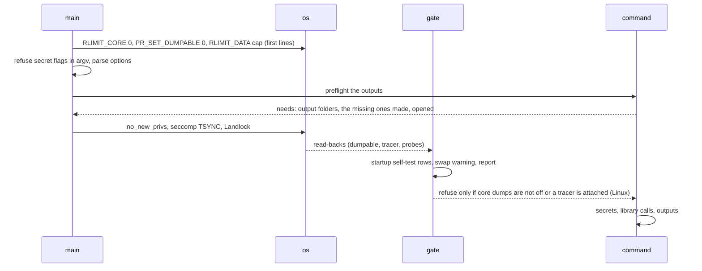

# MnemoCode in Rust: architecture

Design of the Rust MnemoCode for every capability of MnemoCode `7d0d4ee` (TS 0.1.0). Where each
capability goes: `mapping.json`. Decisions that are costly to change: `adr/`. Threats:
`THREAT-MODEL.md`. Gates: `GATES.md`. Order of work: `PLAN.md`. Paths of other repositories
are relative to the workspace that holds MnemoCode beside mhfe and multi-chain-wallet-tools; the
reports are in `docs/design/{assess,platform,crates}/` (README.md says where their evidence is).

## 1. Context and containers



| Container              | What it is                                                | Built from                                                             | Answers                    |
| ---------------------- | --------------------------------------------------------- | ---------------------------------------------------------------------- | -------------------------- |
| `mnemocode` executable | the command line and start menu, one per target           | `mnemocode-cli` with `mnemocode` and `mnemocode-cards`                 | requirement 1, RUST-09..13 |
| `mnemocode.wasm`       | the library's rules for one page, one class per operation | `mnemocode-wasm` with the page profile's `browser-*` and unit features | requirement 5, RUST-15     |

Each page of each wallet-tools edition embeds one file, built with the parts and units it uses
(§9, ADR 0007): the Deriver every part with `browser-cards`, the Discovery Scanner
`browser-candidates` only
(`multi-chain-wallet-tools/apps/discovery-scanner/src/candidate-list-import.ts:11-26`).

Release tooling: tasks of the `xtask` crate, in Rust like every tool of the repository (TOOL-01; owner, 2026-10-27: no Node), and the release workflow:

| Path                            | Capability                         | Does                                                                                                                             |
| ------------------------------- | ---------------------------------- | -------------------------------------------------------------------------------------------------------------------------------- |
| `.github/workflows/release.yml` | CAP-CLI-RELEASE-PIPELINE           | on a tag: the release gates, the executables per target, every page's WASM file, SHA256SUMS, build attestations, a draft release |
| `cargo xtask release build`     | CAP-CLI-SINGLE-EXECUTABLE          | `cargo build --locked --release` per target, assets compiled in                                                                  |
| `cargo xtask wasm build`        | – (§9)                             | one page profile's WASM file and `modules.json`                                                                                  |
| `cargo xtask release pages`     | CAP-CLI-RELEASE-PIPELINE           | every page's WASM file in one archive of the release                                                                             |
| `cargo xtask features`          | – (GATES)                          | GATES `features`                                                                                                                 |
| `cargo xtask reproducible`      | CAP-SSKR-ENGINE-REPRODUCIBLE-BUILD | the rebuild of GATES `reproducible`                                                                                              |
| `cargo xtask sign`              | CAP-CLI-RELEASE-SIGNING            | signs SHA256SUMS with the TS procedure and key                                                                                   |
| `cargo xtask verify-executable` | CAP-CLI-EXECUTABLE-VERIFICATION    | GATES `executable`                                                                                                               |
| `cargo xtask notices`           | CAP-CLI-LICENSE-NOTICES            | GATES `notices`                                                                                                                  |

## 2. Crates and dependency direction



An arrow points from a crate to the crates that may use it. The cause of each crate:

| Crate                                           | Unsafe                                                                                                               | Why it is a crate of its own                                                                                                                                                                                                                                                                                                                                                                                                                                                                                                                                                                                                                                                                                                                                                                       |
| ----------------------------------------------- | -------------------------------------------------------------------------------------------------------------------- | -------------------------------------------------------------------------------------------------------------------------------------------------------------------------------------------------------------------------------------------------------------------------------------------------------------------------------------------------------------------------------------------------------------------------------------------------------------------------------------------------------------------------------------------------------------------------------------------------------------------------------------------------------------------------------------------------------------------------------------------------------------------------------------------------- |
| `mnemocode`                                     | `deny`; allowed only in `secret/pages.rs` and `secret/allocator.rs` (RUST-07)                                        | CORE-01: one library both front ends call                                                                                                                                                                                                                                                                                                                                                                                                                                                                                                                                                                                                                                                                                                                                                          |
| `mnemocode-cards`                               | `forbid`                                                                                                             | Cargo guarantees the rules never depend on drawing (TS `docs/ARCHITECTURE.md`: "Renderers do no mnemonic or share arithmetic"); the drawing crates and 2.5 MB of artwork (`mnemocode/assets`, `du -sh`) build only into the executable and the WASM files with `browser-cards`                                                                                                                                                                                                                                                                                                                                                                                                                                                                                                                     |
| `mnemocode-cli`                                 | `deny`; allowed only under `src/os/`                                                                                 | a binary; the only code with process protections, terminal and files                                                                                                                                                                                                                                                                                                                                                                                                                                                                                                                                                                                                                                                                                                                               |
| `mnemocode-wasm`                                | `forbid` (wasm-bindgen compiles under it: `multi-chain-wallet-tools/packages/recovery-sskr-wasm/rust/Cargo.toml:34`) | wasm-bindgen stays out of the libraries; built once per page profile (§9)                                                                                                                                                                                                                                                                                                                                                                                                                                                                                                                                                                                                                                                                                                                          |
| `shims/bc-crypto`                               | `forbid`                                                                                                             | bc-shamir 0.13.0 takes from bc-crypto only `hash::hmac_sha256`, `memzero` and `memzero_vec_vec_u8`, yet crates.io bc-crypto's defaults compile the C libsecp256k1, which nothing calls and which needs a pinned clang for wasm32 (crates report, decision 3). Our 32-line crate gives the three items over hmac, sha2 and zeroize, with no cryptography of its own; the root manifest's `[patch.crates-io] bc-crypto = { path = "shims/bc-crypto" }` puts it in, and every vendored file stays unchanged. Its proof is the SSKR vectors: the published BCR-2020-011 quorums and the recorded deterministic splits of `vectors/sskr-v1.json`. A workspace member, so `rustfmt`, `clippy` and the lints cover it. Decided (owner, 2026-10-27): nothing ready replaces it (crates report, decision 3) |
| `vendor/sskr-0.12.0`, `vendor/bc-shamir-0.13.0` | `forbid`, in their own `[lints]` tables                                                                              | the SSKR engine as TS vendors it, local changes listed in `UPSTREAM.json` (secret zeroizing, `GroupIndexInvalid`). Workspace members as in TS (`mnemocode/sskr-wasm/rust/Cargo.toml:47`, `package.json:381`), so `rustfmt`, `clippy` and `cargo test --workspace` cover them with their 7 tests and 5 doc tests, which guard those changes (crates report, `work/build-probe-d.log`); exempt from `[lints] workspace = true`; every file byte-equal to `UPSTREAM.json`'s `downstreamSourceSha256` (deps gate)                                                                                                                                                                                                                                                                                      |

Rejected splits (ADR 0001): a crate per model domain (the domains are not layers: masking rules use
the share-form choice, backup reading uses shares and marked codes), a crate per unit (dozens of
manifests for what a feature does), a native-adapter crate apart from the CLI (no second user).

Allowed direct dependencies per crate are a gate (`code-rules`, deps part, over `cargo metadata`),
read from `module-map.json`; manifests pin each with `=x.y.z`:

| Crate                                           | Direct dependencies                                                                                                                                                                                                                                                                                                                                                                                                                                                                                                 |
| ----------------------------------------------- | ------------------------------------------------------------------------------------------------------------------------------------------------------------------------------------------------------------------------------------------------------------------------------------------------------------------------------------------------------------------------------------------------------------------------------------------------------------------------------------------------------------------- |
| `mnemocode`                                     | unicode-normalization, unicode-properties, unicode-script; bip39 (`zeroize`, `chinese-traditional`; only the `bip39` module names it, `lib.rs` never imports it); sha2, hmac, ripemd, sha3, k256, bech32, bs58; chacha20poly1305, hkdf, x25519-dalek, scrypt, base64ct (age); sskr (vendored), bc-rand, rand_chacha, rand_core (the engine's seeded generator, TS `sskr-wasm/rust/src/lib.rs:11-12`); qrcodegen, rqrr, png; zeroize; libc on Unix and windows-sys on Windows (`secret::pages`, `secret::allocator`) |
| `mnemocode-cards`                               | mnemocode; pdf-writer, skrifa, subsetter, tiny-skia, png, miniz_oxide, jpeg-encoder, zune-jpeg, libm, unicode-normalization, unicode-properties, unicode-script                                                                                                                                                                                                                                                                                                                                                     |
| `mnemocode-cli`                                 | mnemocode, mnemocode-cards; getrandom 0.4.3 (the `Random` adapter); libc on Unix, windows-sys on Windows                                                                                                                                                                                                                                                                                                                                                                                                            |
| `mnemocode-wasm`                                | mnemocode, mnemocode-cards (feature `browser-cards`); wasm-bindgen 0.2.129 and getrandom 0.4.3 on every target, so that the native clippy and tests build the binding too and its entries that draw randomness run in the tests; on wasm32: getrandom 0.4.3 with `wasm_js` (the `Random` adapter) and getrandom 0.3.4 with `wasm_js`, only to give bc-rand's tree its browser backend; no js-sys                                                                                                                    |
| `shims/bc-crypto`                               | hmac, sha2, zeroize                                                                                                                                                                                                                                                                                                                                                                                                                                                                                                 |
| `vendor/sskr-0.12.0`, `vendor/bc-shamir-0.13.0` | as their manifests: bc-rand, thiserror, zeroize; sskr also bc-shamir, bc-shamir also bc-crypto (the stand-in)                                                                                                                                                                                                                                                                                                                                                                                                       |

So the CLI and the binding cannot depend on any cryptographic, Unicode or codec crate, and cannot
hold a rule (§10). The same part refuses, anywhere in the resolve of each artifact filtered by its
target (`cargo metadata --filter-platform`), the network, clipboard and browser-API crates that
`module-map.json` names (`refusedInTree`: hyper, reqwest, tokio, socket2, web-sys, js-sys, arboard
and others), and requires `Cargo.lock` to list bc-crypto without a registry source: if the patch
stops matching, Cargo only warns that it is unused, and the crates.io bc-crypto with its C
libsecp256k1 comes back. The runtime crates are the crates report's, agreed by the owner on 2026-10-27
(CORE-25); trees under (d): 82 crates for a WASM file without drawing, 124 for the
whole native set (crates report).

## 3. Module map

A module may use only the modules listed for it; a module of `mnemocode-cards` or `mnemocode-cli`
uses only the modules before it in its list. The repository keeps this table as `module-map.json`
(this design's file, which `make-mapping.py` reads), which the `code-rules` layers check compares
with every `use crate::…`, `mnemocode::…` and `mnemocode_cards::…` path, both ways for the edges
listed besides `F` (a listed edge that no code uses fails too).

Foundation `F` = `secret`, `refusal`, `checksum`, `text`, `random`, `self_check`, `search`; every
library module may use them.

| `mnemocode` module | Holds                                                                                                                                                                                                                                                                                                                                                                                                                                                                                                                                                                                                                                                                                                                                                         | May use (besides `F`)                                 | Unit features                                       |
| ------------------ | ------------------------------------------------------------------------------------------------------------------------------------------------------------------------------------------------------------------------------------------------------------------------------------------------------------------------------------------------------------------------------------------------------------------------------------------------------------------------------------------------------------------------------------------------------------------------------------------------------------------------------------------------------------------------------------------------------------------------------------------------------------- | ----------------------------------------------------- | --------------------------------------------------- |
| `lib`              | the crate root: declares the parts and their unit features (CAP-CLI-PORTABLE-PARTS)                                                                                                                                                                                                                                                                                                                                                                                                                                                                                                                                                                                                                                                                           | every module                                          | –                                                   |
| `secret`           | owner types, page locks, the zeroing allocator, the stack scrub (§6)                                                                                                                                                                                                                                                                                                                                                                                                                                                                                                                                                                                                                                                                                          | `refusal`                                             | –                                                   |
| `refusal`          | the `Refusal` trait (§7)                                                                                                                                                                                                                                                                                                                                                                                                                                                                                                                                                                                                                                                                                                                                      | –                                                     | –                                                   |
| `checksum`         | CRC-32/ISO-HDLC and its big-endian read (TS `src/sskr/checksum.ts:4-32`), with the check value of `123456789` as its unit test; built without any feature, since shares, candidate lists and PNG admission use it                                                                                                                                                                                                                                                                                                                                                                                                                                                                                                                                             | –                                                     | –                                                   |
| `text`             | ECMAScript white space for tokens, one trim (Unicode White_Space, `str::trim`), NFKD and NFC, strict UTF-8, safe display, cell widths; the wording and reading pieces every part shares (TS `src/core/`): a whole number in a range, its wording and `core.typed-number.typed-whole-number-refused` (`typed-number.ts`), list, place and number words (`places.ts`, `prose.ts`), code tokens and hex units (`code-text.ts`), bytes as hex (`bits.ts`), text pieces (`pieces.ts`), byte-limit names (`byte-units.ts`)                                                                                                                                                                                                                                          | `refusal`                                             | –                                                   |
| `random`           | the `Random` port, uniform choice                                                                                                                                                                                                                                                                                                                                                                                                                                                                                                                                                                                                                                                                                                                             | `refusal`                                             | –                                                   |
| `self_check`       | `Tier`, `Check`, `CheckFailure`; the public vectors the rows share (TS `src/core/self-test-vectors.ts`), as constants the units' and the cards' rows read; `checks` only orders the rows                                                                                                                                                                                                                                                                                                                                                                                                                                                                                                                                                                      | `refusal`                                             | –                                                   |
| `search`           | `Search`, `Step`, bounded counts, plan (ADR 0005)                                                                                                                                                                                                                                                                                                                                                                                                                                                                                                                                                                                                                                                                                                             | `refusal`, `text`                                     | –                                                   |
| `bip39`            | MnemoCode's side of BIP39 over the bip39 crate, which decides all that BIP39 defines: typed phrases read (tokens from `text`, the count and word-place refusals with the crate's `find_word`, then `parse_in_normalized` and `to_entropy_array`), search candidates checked the same way from their canonical words, checksum-valid last words from the known words' entropy (`parse_in_normalized_without_checksum_check`, `to_entropy_array`) with each value of its free last bits through `from_entropy_in`, words from entropy (`from_entropy_in`), the seed (`to_seed_normalized`); sizes for plans and messages; table rows and numbered dictionaries over the crate's two lists; the bit packing of word indexes for the share layouts (TS `bits.ts`) | –                                                     | –                                                   |
| `dates`            | dates, patterns, shift schedule, the dates answer                                                                                                                                                                                                                                                                                                                                                                                                                                                                                                                                                                                                                                                                                                             | –                                                     | –                                                   |
| `bip32`            | master key and fingerprint, child keys, extended keys                                                                                                                                                                                                                                                                                                                                                                                                                                                                                                                                                                                                                                                                                                         | `bip39`                                               | –                                                   |
| `pack`             | recovery guide and pack files                                                                                                                                                                                                                                                                                                                                                                                                                                                                                                                                                                                                                                                                                                                                 | `bip39`                                               | –                                                   |
| `qr`               | PNG admission, QR read, verified QR PNG, QR matrix                                                                                                                                                                                                                                                                                                                                                                                                                                                                                                                                                                                                                                                                                                            | –                                                     | –                                                   |
| `candidates`       | MNCL v1, writer, admission, protection choice, age, its gate                                                                                                                                                                                                                                                                                                                                                                                                                                                                                                                                                                                                                                                                                                  | `bip39`                                               | –                                                   |
| `forms`            | the five encoded forms (registry), detection, word hints, colour placements                                                                                                                                                                                                                                                                                                                                                                                                                                                                                                                                                                                                                                                                                   | `bip39`                                               | –                                                   |
| `modes`            | the four modes (registry), Seedshift, legacy-valid last words                                                                                                                                                                                                                                                                                                                                                                                                                                                                                                                                                                                                                                                                                                 | `bip39`, `dates`, `bip32`                             | –                                                   |
| `wallet`           | coins (registry), location, scan, evidence and `WalletMatch`                                                                                                                                                                                                                                                                                                                                                                                                                                                                                                                                                                                                                                                                                                  | `bip39`, `bip32`                                      | `coin-*`                                            |
| `backup`           | encoded backup, MNC1 record, JSON, encoded fingerprint, shorter phrases, legacy reading, re-encoding                                                                                                                                                                                                                                                                                                                                                                                                                                                                                                                                                                                                                                                          | `bip39`, `dates`, `bip32`, `forms`, `modes`, `wallet` | –                                                   |
| `sskr`             | engine bridge, share forms, set, split, restore, repair, joint search, report, typed shares, export, keeping note                                                                                                                                                                                                                                                                                                                                                                                                                                                                                                                                                                                                                                             | `bip39`, `dates`, `bip32`, `forms`, `modes`           | `sskr`                                              |
| `recovery`         | backup reading, places, marked codes, date, word and marked-code searches, backup check, share restore flows                                                                                                                                                                                                                                                                                                                                                                                                                                                                                                                                                                                                                                                  | all above but `qr`, `pack`                            | `search-date`, `search-word`, `search-marked-codes` |
| `checks`           | the ordered self-check rows                                                                                                                                                                                                                                                                                                                                                                                                                                                                                                                                                                                                                                                                                                                                   | every module                                          | –                                                   |

`mnemocode-cards`, in order: `assets`, `text_rules`, `settings`, `palette`, `scene`, `pdf`,
`raster`, `content`, `details`, `sheet`, `templates` (registry, features `template-*`), `plan`,
`heir`, `export`, `preflight`, `checks`. It may use the library's `F`, `bip39`, `dates`, `forms`, `modes`, `backup`,
`sskr`, `qr`. A template draws a backup's or a share's content with the details and the sheet's
study (TS `business-cards.ts:1,14,16,18,27-28`, `material-cards.ts:21-27,37-38`), so `content`
holds both content types (TS `CardContent`, `SskrCardContent`) and the decoy count
(`card-decoys.ts` `ownCards`), and `scene` the box and text-fitting primitives that sheets and
templates share (`business-layout.ts`, `business-render-primitives.ts`). Three TS uses of the
catalog by modules now below `templates`, which the model's graph misses, become values: each
template entry names its employer's sector, which the caller passes to `details` (TS
`card-identities.ts:3,140-152`, `card-session.ts:80`), and `export` asks the entry whether it draws
separate cards (TS `sskr-content.ts:10,97`, `template-catalog.ts:118`).

`mnemocode-cli`, in order: `os` (protections, signals and exit cleanup, staging folders, system
readings with the swap reading, sandbox report, the termios and console-mode calls that `terminal`
and the N-SIGNALS handler use), `terminal`, `args` (option table and help as data), `input`,
`output`, `gate` (startup order, secret gate, startup rows, the swap warning's words), `commands`,
`menu`, `main`.

`mnemocode-wasm`: `host` (secrets in and out, refusals, the `Random` adapter, the allocator's
registration, `secret::scrub_stack` after each secret call), then one module per library part,
each behind its feature: `phrase`, `wallet`, `sskr`, `recovery`, `candidates`, `qr`, `cards`. Each
module exports its own `selfCheck` (mhfe's pattern, `mhfe/src/wasm_api.rs:20-24`). A refusal leaves
the binding as the JavaScript error of TS's kind (`Error`, `RangeError`, `TypeError`, the library's
`Refusal::kind`) with a read-only `code`. `probe`, behind `browser-probe`, holds the memory scan's
own entries and builds only into the test profile `test/probe`, never into a page's file.

`make-mapping.py` checks the 740 model edges against this map: all conform, apart from 51 edges
the design removes or redraws (14 of them touch a dropped capability), each listed with its reason
in `MOVED`; for example the share form a mode allows moves from `modes` to `sskr::forms`, and a
search returns its candidates for the front end to save instead of saving them. The map also has
edges the model's graph misses, found in the TS imports: `candidates` uses `bip39` (MNCL reading
gives English phrases, the writer checks phrases: `src/core/candidate-list.ts:11,14-15`,
`candidate-list-writer.ts:14-18`); `sskr`, `candidates` and `qr` use `checksum`
(`candidate-list.ts:12`, `png-admission.ts:7`); and low modules use `text`'s shared pieces, which
the model gives to capabilities of the CLI and `sskr` (`typed-number.ts` to CAP-CLI-OPTION-PARSING,
with 15 library importers and a refusal of CAP-WALLET-ADDRESS-LOCATION; `places.ts` to
CAP-SSKR-SHARE-TROUBLE; `code-text.ts` to CAP-SSKR-MARK-SYNTAX): `bip39-sizes.ts:10-11`,
`word-table.ts:5,7`, `words.ts:2,28`, `colors.ts:14-17`, `dates.ts:2`, `coins/coin.ts:15`,
`address-scan.ts:14`, `search-turns.ts:10`, `png-admission.ts:6`; `sskr` and the cards use `dates` (a split masks with its dates and its row reads a masked date: `src/sskr/split.ts:15,56,158`, `split-self-test.ts:14`; the card preview's sample dates: `src/export/card-preview.ts:22,77`); and the units' rows read `self_check`'s shared vectors (`core/coins/coin-self-test.ts:23`, `sskr/split-self-test.ts:20`, `export/cards-self-test.ts:21` and 13 more). One edge the map adds is
redrawn the other way: the swap warning's reading moves to `os`, and the gate words it.

## 4. Host services: ports and adapters

Only services that differ by host and need a test fake are seams (CORE-09, CORE-13).

| Service              | Seam                                                    | Linux                          | macOS                  | Windows                                   | Browser                                      | Test                        |
| -------------------- | ------------------------------------------------------- | ------------------------------ | ---------------------- | ----------------------------------------- | -------------------------------------------- | --------------------------- |
| Randomness (CORE-46) | `random::Random` trait                                  | getrandom 0.4.3 (getrandom(2)) | getrandom (getentropy) | getrandom (ProcessPrng)                   | getrandom `wasm_js` (crypto.getRandomValues) | `FixedRandom` in tests only |
| Secret page locks    | `cfg` in `secret::pages`, no trait                      | mlock                          | mlock                  | VirtualLock after raising the working set | none, reported                               | –                           |
| Wipe on free         | `secret::ZeroingAllocator`, registered by each artifact | zero                           | zero                   | zero                                      | zero                                         | B-WIPE scan                 |

Every trait of the design and its cause: `Random` (CORE-46: randomness from outside, a fake in
tests); `Refusal` (CORE-23: one code and one message per condition); `Search` (ADR 0005: two hosts
step five searches); `Check` (CORE-27, CORE-31: rows come from each unit); one trait per registry
(requirement 3, CORE-06); mhfe's `Probes` in the CLI (the report's tests need refused probes).

No seam, by decision (ADR 0006): the bip39 crate with its PBKDF2, HMAC, the SSKR engine, QR, PNG, JPEG and font code are
linked, one implementation everywhere; the clock stays with the host, which times each search's
public pace sample before consent and the steps it drives (ADR 0005; `Instant::now` traps on
`wasm32-unknown-unknown`, crates report decision 9); the wallet check is the library's own, fed
with evidence as data; bundled files are compiled in; page images are drawn in process (ADR 0009).

The CLI's own platform code is selected by `cfg` per target in `mnemocode-cli::os`; no trait, except
mhfe's `Probes` (`mhfe/src/bin/mhfe/protect.rs:329`), the one fake its report tests need:

| Service                | Linux                                                                                         | macOS                   | Windows                                         |
| ---------------------- | --------------------------------------------------------------------------------------------- | ----------------------- | ----------------------------------------------- |
| No core dumps          | RLIMIT_CORE 0, PR_SET_DUMPABLE 0, both read back                                              | RLIMIT_CORE 0 read back | WerSetFlags(NOHEAP) read back, LocalDumps named |
| Readers, injected code | dumpable, TracerPid                                                                           | PT_DENY_ATTACH          | DLL search order, mitigation policies           |
| Network, writes        | seccomp TSYNC; Landlock on the parent folder of each output, the private screen included (§5) | Seatbelt (network)      | – (no unprivileged sandbox)                     |
| Memory cap             | RLIMIT_DATA, free-memory check                                                                | free-memory check       | job memory limit, free-memory check             |
| Swap                   | /proc/swaps to dm-crypt, zram without backing_dev                                             | – (encrypted)           | – (cannot tell)                                 |
| Terminal, signals      | termios, sigaction                                                                            | termios, sigaction      | console modes, console control handler          |
| Files                  | create-new 0600/0700, staging beside, link or rename                                          | same                    | same, folder ACL named                          |

Measures and read-backs: `THREAT-MODEL.md` and `design/platform/protections.json`.

## 5. Process model of the command line

Every secret command runs in a fresh process of the same executable (the menu starts it); its
protections are set before its first thread and read back before its first secret (ADR 0008).



macOS: RLIMIT_CORE, PT_DENY_ATTACH, then Seatbelt once the needs are known. Windows:
SetDefaultDllDirectories, WerSetFlags, the job with its memory cap, then the read-backs.

Landlock grants writes beneath the parent folder of each output, opened before the secret; the
preflight makes a missing parent, with any missing folders above it, before the secret (owner, 2026-10-27;
TS makes them at publication, `private-file.ts:271`), so staging beside the destination and the
final reservation work as TS. Folders made so stay after a cancel: the restricted process cannot
remove the folder its rule sits on (Landlock's REMOVE_DIR covers a folder's content only). A command that saves nothing gets no write
rule, as TS. Write rules need ABI 2 (REFER): on ABI 1 a command that saves applies no Landlock,
and the Protection line says so (L-LANDLOCK-WRITES). The rules apply on the private screen too
(owner, 2026-10-27): re-encode asks its new backup's outputs before the old phrase (TS asks them after
it, `src/cli/command-options.ts:185`, `re-encode-command.ts:478-488`), when a second Landlock
restriction rules their folders (`Protection::rule_writes`), and a failed save's new
name (CAP-CLI-SAVE-RETRY) is taken only in the folders ruled before the secret; another folder is
refused, naming the ruled ones. Both change TS 0.1.0's dialogue on purpose (RUST-14, the owner's decision; PLAN, "Parity with TS
0.1.0"). `recover-word` alone leaves writes open on its private screen: the candidate list that it
offers is named after the search, as in TS, and the Protection line says so. The start menu holds no
secret and writes nothing; it takes no sandbox, which its commands would inherit, and each command
sets its own.

A command whose result is secret needs a private screen when standard output is a terminal,
whatever `TERM` says: without one it refuses before asking any secret, so nothing secret reaches the
terminal's scrollback; to a file or a pipe the result is written as TS (owner, 2026-10-27;
N-PRIVATE-SCREEN, as mhfe's AUD-007-SEC001 for the terminal case). The lines of a result that TS
writes to standard error go to standard output where standard error is a terminal with no private
screen.

Signals (N-SIGNALS): the handlers for SIGINT, SIGTERM, SIGHUP and SIGQUIT only set a flag (no
`SA_RESTART`; other threads block them). The main thread wakes on `EINTR` from its terminal read,
which it does not retry, checks the flag before each read of standard input or a file, and between
`Search::step` calls; `main` checks it once more when the command ends, whatever its result. It
then restores the terminal, leaves the private screen, removes the staging folders and exits with
128 + the signal number (130 and "Cancelled." for SIGINT and SIGQUIT). Removing folders is not async-signal-safe,
hence the flag. The Windows console handler sets the flag and, for `CTRL_CLOSE_EVENT`, waits for
the cleanup within 5 s. SIGTSTP stops the command after leaving raw mode, and on continue raw mode
comes back; the private screen stays up, so nothing is drawn again, as in TS.

## 6. Secrets

Owner types in `mnemocode::secret` (ADR 0003): `SecretBytes` and `SecretText` hold a buffer reserved
at its final size, locked before it is filled, never grown, zeroized and unlocked on drop; `Debug`
prints `[<Label>: redacted]`; neither has `Display`. Domain owners (`Phrase`, `Entropy`, `Seed`,
`ExtendedPrivateKey`, `Dates`, `EncodedBackup`, `Share`, `Passphrase`, `CandidateList`) wrap them
and lend slices; small fixed-size values are kept inside them, not as arrays passed by value.
Locks are counted per page as in `mhfe/src/memory.rs:231-349`, so small secrets share pages within
the lock budget (8 MiB since Linux 5.16, 64 KiB before, platform report). An owner over the budget
is not locked: the allocator wipes it, and the lock warning says so
(RUST-13: "where their size allows"). Behind every artifact, the global allocator zeroes each
freed block, so copies that dependencies make (unicode-normalization's output, scrypt's work
area, `scrypt-0.12.0/src/lib.rs:119,133-134`, which never wipes it) and wasm-bindgen's argument
copies (`wasm-bindgen-0.2.129/src/rt/mod.rs:699-772`, all through the global allocator) are wiped
too. It never hands `realloc` to the system allocator: the new block is allocated, the bytes
copied, the old block wiped and freed, shrinks included, so the glue's growing and shrinking string
buffers (`wasm-bindgen-cli-support-0.2.129/src/js/mod.rs:3078-3088`) and a growing `Vec` leave
nothing behind. No block is marked MADV_DONTDUMP: a process whose dumpable reads 0 is never
dumped (L-DUMPABLE; RUST-13 as the owner amended it on 2026-10-27).

| Secret                                               | Enters from                                                                                                                                           | Lives in                                                                                                                                                                                                  | Ends                                                                                                                                                                                                                                       |
| ---------------------------------------------------- | ----------------------------------------------------------------------------------------------------------------------------------------------------- | --------------------------------------------------------------------------------------------------------------------------------------------------------------------------------------------------------- | ------------------------------------------------------------------------------------------------------------------------------------------------------------------------------------------------------------------------------------------ |
| Typed line (phrase, codes, dates, share, passphrase) | prompt, file, standard input, QR image                                                                                                                | the CLI's answer buffer at its question's limit (PLAN, "Owner decisions"; TS: 1 MiB), a `SecretBytes` locked within the budget, or the binding's argument copy                                            | dropped once parsed into its owner                                                                                                                                                                                                         |
| Phrase, entropy, word indexes                        | parse, decode, restore, search                                                                                                                        | `Phrase`, `Entropy`; the bip39 crate's `Mnemonic` (50 bytes, `ZeroizeOnDrop`) only on the stack inside one `bip39` call, its returned arrays copied into the owners and wiped                             | end of the operation; a search keeps one working phrase and its found entropies in one `SecretBytes` reserved, when the search is made, at min(candidates, keep) × entropy length (keep = 2^19 + 1, TS `src/core/candidate-list.ts:63,71`) |
| Seed, master and child private keys                  | `bip39::seed` (the crate's `to_seed_normalized` with the NFKD passphrase in a `SecretText`; the returned array copied into `Seed` and wiped), `bip32` | `Seed`, `ExtendedPrivateKey` (k256 keys zeroize themselves)                                                                                                                                               | after the fingerprint or address is computed                                                                                                                                                                                               |
| Dates                                                | prompt, file                                                                                                                                          | `Dates`; shift schedule in `SecretBytes`                                                                                                                                                                  | end of the operation                                                                                                                                                                                                                       |
| Codes, MNC1 record, JSON                             | encode                                                                                                                                                | `EncodedBackup`, `SecretText`                                                                                                                                                                             | after it is written to the private screen, a file, a QR or a card                                                                                                                                                                          |
| Shares                                               | split, files, prompt, QR                                                                                                                              | `Share` (UR bytes); the engine bridge wipes its buffers                                                                                                                                                   | after output or restore                                                                                                                                                                                                                    |
| BIP39 passphrase, list passphrase, WIF               | files, prompt                                                                                                                                         | `Passphrase`, `SecretText`, key owner                                                                                                                                                                     | after the check or encryption                                                                                                                                                                                                              |
| Candidate list                                       | searches                                                                                                                                              | one `CandidateList` for the whole list, reserved at its exact size from the count (up to 155,189,248 bytes, CAP-RECOVERY-CANDIDATE-LIST-FORMAT)                                                           | after encryption or saving                                                                                                                                                                                                                 |
| The Discovery Scanner's X25519 identity              | the `candidates` binding, from the `Random` port                                                                                                      | an owner (`SecretBytes`) inside a binding class for the page's life; only its age1 recipient leaves the WASM (`multi-chain-wallet-tools/apps/discovery-scanner/src/candidate-list-import.ts:166-187`)     | `wipe()` or `free()`                                                                                                                                                                                                                       |
| Finished PDFs, page images                           | cards crate                                                                                                                                           | `SecretBytes` (large: not locked, wiped on free)                                                                                                                                                          | after publication                                                                                                                                                                                                                          |
| Card codes and pages being drawn                     | cards crate                                                                                                                                           | `CardCodes` and `Page`: redacted, wiped on free, not locked (the owner's call under RUST-13, PLAN.md); a page lives until it is written, and a command's PDF is written to its staged file as it is drawn | after the page or the export                                                                                                                                                                                                               |
| Working vectors of a repair of shares                | the shares, at the search of marked shares                                                                                                            | `JointSearch`'s `Vec`s: redacted, wiped on free, not locked (the owner's call under RUST-13, PLAN.md)                                                                                                     |                                                                                                                                                                                                                                            |
| Text shown or saved                                  | the owners above                                                                                                                                      | terminal (private screen), files (0600), JS string (browser)                                                                                                                                              | private screen cleared; files are the person's; a JS string cannot be wiped (DOC-07)                                                                                                                                                       |

The CLI reads the terminal and standard input with read(2) on descriptor 0 (`ReadConsoleInputW` and `ReadFile` on Windows) straight into the answer's `SecretBytes`, and writes secret text with write(2) (`WriteConsoleW`) on its descriptor: std's `stdin()` and `stdout()` never carry a secret: their static `BufReader` (8 KiB) and `LineWriter` are never freed, so the allocator never wipes the last input or unflushed piece (Rust 1.99.1 <https://github.com/rust-lang/rust/blob/1.99.1/library/std/src/io/stdio.rs>, lines 341-345, 647 and 722; mhfe reads typed secrets through `io::stdin().lock()`, `hidden_input.rs:106,114,144`). `clippy.toml` disallows `std::io::stdin` and `std::io::stdout` in the CLI outside `os`, which offers the descriptor reads, writes and terminal checks.

In the WASM: a secret text crosses as a `JsValue`, which the entry reads into a Rust `String` inside
the call (`host::text`, `optional_text` for one TS defaults to empty), and secret bytes as a `&[u8]`
that is the first argument of a free function; the copies are freed through the zeroing allocator
once the Rust entry returns. A copy the glue makes is freed only then: the glue checks a later
argument (`_assertClass`, `_assertChar`, `_assertNonNull`, the length of a string that is
`undefined`) after it has copied the secret, the receiver of a method is checked inside the call
(a freed object's null pointer, `wasm-bindgen-0.2.129/src/rt/mod.rs:297,475`), and a wasm-bindgen
enum's `from_abi` throws inside the call, so a throw there leaves the copy never freed, so never
wiped (`wasm-bindgen-cli-support-0.2.129/src/js/binding.rs:836-839,906-914,959-975`,
`wasm-bindgen-macro-support-0.2.129/src/codegen.rs:5064`). A binding entry that takes a secret
therefore takes every other argument as a number, a boolean or a `JsValue`, converted and refused
inside Rust: no `&str`, no wasm-bindgen enum or class argument and no `Option` of one (TS
AUD-012-SEC001, `mnemocode/sskr-wasm/rust/src/lib.rs:89-90,141`); a text that is not one is
refused as TS refuses secret storage of another type (`core.secret-value.text`), and a name that
is not one as the library refuses an unknown name. A search that compares with a wallet therefore
starts from a receiver that holds it (`recovery::Recovery`, made by `WalletEvidence.recovery`). The bytes a method takes are never secret (an
encrypted file). Numbers cross as `f64`, since the glue narrows an
integer type (`js as u8`, `wasm-bindgen-0.2.129/src/convert/impls.rs:292-333`; TS
`src/sskr/bridge.ts:1-6`, AUD-014-API008). A trap (`panic = "abort"`) runs no `Drop` and leaves
every live secret in the instance's memory, so the binding's contract tells the page to drop the
instance after a `WebAssembly.RuntimeError`. A secret result leaves as one JS string on request; the
binding calls `secret::scrub_stack` (safe code over zeroize) after each secret call
(CAP-SSKR-ENGINE-MEMORY-WIPE, generalised). Its size is one named constant set from the deepest
stack measured over every secret entry, with the measurement and the margin written beside it, as TS
did for the engine alone (16 KiB, more than five times the 2,936 bytes measured,
`sskr-wasm/rust/src/lib.rs:22-25`). The `wasm` gate measures it on each build: the rows of the
self-check, the known answers of each part's secret work on public data (the bip39 crate's seed,
k256, scrypt, the QR reader, and with their increments the searches and card drawing), run in the
test profile on a painted stack, and a row that leaves data as deep as the scrub reaches is
refused; the QR reader goes deepest, some 77 KiB against 128 KiB. Zeros are no data: the share
engine scrubs by itself, so that its own depth does not show, and whatever it leaves past the
scrub's reach still does. The scrub also removes the crate's stack copies (entropy bits, PBKDF2 pads
and HMAC states, returned arrays), which it never wipes. A page wipes the `Uint8Array`s it passes
(WEB-04). The test is the B-WIPE scan of `memory.buffer` (GATES `wasm`). One instance tells each
secret that `probeEntries` meets; in a second, it calls the Rust function behind every secret entry
with what a page passes and no scrub but the entry's own. The gate paints the stack under each
entry and looks at it after each return: no told secret lies there and the paint is gone from what
the scrub reaches, which shows the scrub ran whatever form a secret took. After the last return no
part of a secret, a seed, a key or a share lies in the memory. The
generated wrappers are not run: they pass on references and the page's string handles alone.

## 7. Refusals and messages

```rust
/// A refusal with the stable code of TS 0.1.0; its Display is the one message.
pub trait Refusal: std::error::Error {
    fn code(&self) -> &'static str;
}
```

- One error enum per module (RUST-04), one variant per condition; `code()` returns the TS string
  (`core.words.unknown-english-bip39-word-at-position`), `Display` writes the TS message byte for
  byte (RUST-14). A variant carries positions, counts and option names, never typed text (CORE-24).
- Codes are API: kept as TS 0.1.0, apart from the renames and new refusals the owner decided on
  2026-10-27, made in the TS first (ADR 0004). Codes that only guarded
  JavaScript types or the program's own data are not written; `vectors/ts-0.1.0/refusals-v1.json`
  lists every TS code, and `cargo xtask code-rules` finds each code of the port there or in its own
  list.
- The CLI prints `✗ Error: <Display>` with the TS exit codes; its own conditions (options, files,
  terminal) are enums of its own modules under the same trait. The binding turns any `Refusal` into
  `{ code, message }` in one function; a page shows the message or its own words for the code.

## 8. Registries, units and features

One pattern for every registry (ADR 0002): a trait, one module per entry, one static list.

```rust
pub static COINS: &[&dyn Coin] = &[
    #[cfg(feature = "coin-bitcoin")] &bitcoin::BITCOIN,
    #[cfg(feature = "coin-dash")] &dash::DASH,
    // ...
];
```

| Registry                     | Trait               | Entries                                                 | Feature per entry                 | Read by                                             |
| ---------------------------- | ------------------- | ------------------------------------------------------- | --------------------------------- | --------------------------------------------------- |
| `wallet::coins`              | `Coin`              | 12 coins                                                | `coin-<id>`                       | evidence, `--coin`, help, menu, binding's coin list |
| `forms`                      | `EncodedForm`       | 5 forms, numbers 1-5                                    | – (every host takes every form)   | detection, `--format`, records, cards               |
| `modes`                      | `Mode`              | 4 modes                                                 | –                                 | `--mode`, records, menu                             |
| `sskr::forms`                | `ShareFormat`       | 6 share forms                                           | – (with `sskr`, every share form) | share reading in order, `--format`, cards           |
| `mnemocode_cards::templates` | `CardTemplate`      | 13 designs in the TS order                              | `template-<id>`                   | `--template`, `preview --list`, menu                |
| `checks`                     | `self_check::Check` | rows in the TS order; a unit's rows come from its entry | the unit's                        | gate, `self-test`, each binding's `selfCheck`       |

Adding a coin or card design: its module with its known answers, one registry line, one feature in
the crate's manifest and in the edition profiles; a share form, a variant of `ShareFormat`. The
core, the front ends and the binding do not change: options, help lists, menu answers and self-test
rows are read from the registry. A registry's unit test fixes ids, numbers and order (recorded commands, RUST-14).

Searches (date, word, marked codes) are units too: features `search-date`, `search-word`,
`search-marked-codes` gate their `Search` types; the readers they share (places, marked codes,
dates answer) are always built. Without `search-date` a dates answer refuses patterns, as TS does
for a host that does not search.

## 9. Features and the WASM file of each page

| Crate             | Features                                                                                                                                                                                                                                                                                                                  |
| ----------------- | ------------------------------------------------------------------------------------------------------------------------------------------------------------------------------------------------------------------------------------------------------------------------------------------------------------------------- |
| `mnemocode`       | `coin-*` (12), `sskr`, `search-date`, `search-word`, `search-marked-codes`; default all                                                                                                                                                                                                                                   |
| `mnemocode-cards` | `sskr` (implies `mnemocode`'s `sskr`: the share-card content type, share card sets, separate share cards, the heir sheet's share lines), `template-*` (13; `template-business-mixed` implies the seven other business designs, whose artwork it draws); default all. It takes `mnemocode` with `default-features = false` |
| `mnemocode-wasm`  | `browser-phrase`, `-wallet`, `-sskr`, `-recovery`, `-candidates`, `-qr`, `-cards`; `browser-cards` forwards the cards' `sskr` only in a profile with `sskr` (wallet-tools builds cards without shares: `tooling/key-derivation-features.mjs:145-152`)                                                                     |

`wasm-profiles.json` names, per wallet-tools edition and page, the `browser-*` modules and the
unit features (today `multi-chain` Deriver: all; `multi-chain` Discovery Scanner:
`browser-candidates` and no unit; `dash-community`: `coin-dash` and what the wallet-tools session
asks; `multi-chain-wallet-tools/tooling/key-derivation-features.mjs:115-162` already removes share,
card and coin parts by edition). `cargo xtask wasm build <edition>/<page>` builds the file for
`wasm32-unknown-unknown` with `--no-default-features --features <modules>,<units>` and no getrandom
cfg in RUSTFLAGS (the binding's direct getrandom 0.3.4 line with `wasm_js` selects bc-rand's
backend; TS `Dockerfile.sskr:67-74` sets a cfg that is no longer needed, crates report decision 9),
runs wasm-bindgen 0.2.129, removes the glue's network loader as mhfe's
remove-network-code does, and writes the file with `modules.json` (version, build id,
SHA-256), as mhfe's package does. The artifact gate checks per profile that the exports match the
profile's modules and that no word of a left-out unit is in the bytes (CORE-31). One file per
page.

## 10. Thin front ends

- The CLI and the binding may depend only on `mnemocode`, `mnemocode-cards`, libc, windows-sys,
  wasm-bindgen and getrandom (§2, deps gate): no cryptography, Unicode, codec or drawing crate, so
  a rule cannot live there.
- Every early refusal of a front end calls a library rule or reads a library value (registries,
  limits, `parameters()`), CORE-10.
- Messages come from `Display` of library refusals; the front ends word only their own
  conditions.
- The binding is thin, so a result can differ from the command line only by what the target
  changes: its unit tests run with every module, and `cargo xtask wasm verify` runs the known answers
  of the self-check rows inside wasmi, an interpreter of WebAssembly in Rust, on `test/probe`, which
  is the 32-bit target.
- Each binding module is a translation of one library module and builds alone (`clippy` per
  `browser-*` feature), RUST-15.
